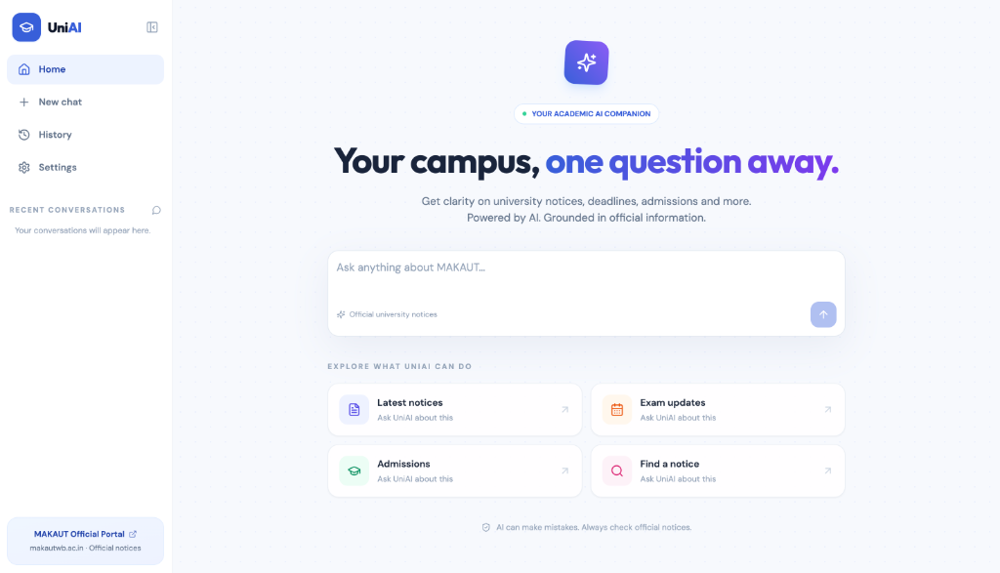
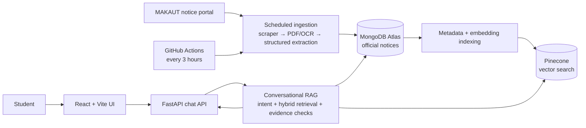

# 🎓 University Intelligent Question Answering System (UniAI)

> **An end-to-end, production-ready AI academic companion that automatically collects official university notices, extracts structured intelligence, and delivers verified, conversational answers grounded in official circulars with clickable citations.**

<p align="center">
  
</p>

🎯 **Target:** Final Year B.Tech CSE Capstone Project  
🏫 **University:** Maulana Abul Kalam Azad University of Technology (MAKAUT), West Bengal  
👨‍💻 **Author:** Farhan Akhtar (B.Tech — Computer Science & Engineering)  
🤖 **Core Technologies:** Python 3.9+ • FastAPI • React 18 • Vite • Tailwind CSS • MongoDB Atlas • High-Res OCR (300 DPI + Tesseract) • Pydantic V2 • LangChain • Ollama (`qwen3:4b-instruct`) / Groq (`llama-3.3-70b-versatile`) • Pinecone Vector DB  

---

## 📌 Executive Overview

University students frequently struggle to find crucial academic information scattered across dozens of official circulars, examination notifications, admission schedules, fee updates, and academic notices published as unstructured PDFs.

**UniAI** solves this challenge by building an **intelligent, end-to-end university question-answering system**:
1. **Continuously monitors** university portals to ingest raw PDF circulars with cryptographic deduplication.
2. **Extracts and validates** structured data using high-resolution OCR, Pydantic V2 contracts, and LLM structuring (Ollama / Groq).
3. **Indexes circulars** into a serverless vector database (Pinecone) with academic year metadata and integrated embeddings.
4. **Employs a multi-turn Conversational RAG pipeline** that enforces strict evidence grounding, atomic claim validation, and zero hallucinations.
5. **Automates synchronization** via scheduled cloud tasks in GitHub Actions with dynamic MongoDB Atlas IP authorization.
6. **Delivers a modern web application** (React 18 + Vite + Tailwind CSS) where all links, official documents, and citations are fully interactive and clickable.

### 💡 Example Interactions

```text
Student: "What documents do I need for WBJEE 2026 admission reporting?"
UniAI:   "For WBJEE 2026 admission reporting at MAKAUT, you must submit:
          1. WBJEE 2026 Allotment Letter & Rank Card
          2. Class 10 & Class 12 Admit Cards & Marksheets
          3. Domicile Certificate and Category Certificate (if applicable)
          4. Anti-ragging declarations and medical fitness certificate.

          Source: https://makautwb.ac.in/datas/users/0-wbjee_reporting_2026.pdf"

Student: "Give me 3 latest notices"
UniAI:   [Returns 3 newest notices formatted with dates, summaries, and official links]

Student: "Now the second one"
UniAI:   [Expands specifically on the second notice from the previous list]

Student: "Which of these two hostel deadlines comes first, and by how many days?"
UniAI:   [Compares both notices, computes the exact date difference, and cites both sources]
```

---

## 🚀 Key Features

* 🔄 **Automated Portal Monitoring:** Continuously scans the MAKAUT notice portal and discovers newly published circulars without manual document uploads.
* 🔐 **Cryptographic Deduplication:** Generates deterministic SHA-256 identifiers to guarantee idempotency and avoid duplicate database records.
* 📄 **Dual-Path Text Extraction:** Native PyPDF digital extraction first (instant, 100% accurate); automatically falls back to 300 DPI Tesseract OCR with contrast enhancement (1.5x) for scanned notices.
* 🔍 **Enhanced OCR Preprocessing:** Corrects font slant misreads (`JJ` $\rightarrow$ `11 a.m.`), repairs spurious spaces in dates (`01.1 0.2026` $\rightarrow$ `01.10.2026`), and trims university crest noise.
* 📐 **Strict Pydantic Validation:** Formats unstructured notices into 10 structured dimensions (`ConfigDict(extra="forbid")`) with custom field validators.
* 🧩 **Intelligent Long-Document Chunking:** Segments long circulars (> 7,000 characters) along paragraph boundaries and merges chunk extractions deterministically with conflict detection.
* 🔢 **Pinecone Serverless Vector Store:** Synthesizes structured fields into integrated dense embeddings tagged with 4-digit academic years.
* 🧠 **Query Understanding Layer:** Classifies user intent across 9 distinct categories, resolves temporal constraints, detects topic switches, and remembers student names.
* 💬 **Multi-Turn Conversational Memory:** Maintains session state, active notice focus, ordinal selections (*"3rd one"*), and exact citation tracking for multi-document comparisons.
* 🛡️ **Anti-Hallucination & Claim Verification:** Server-side validator checks generated claims against atomic fact references, rejecting fabricated figures, unsupported dates, or altered currencies.
* ⏰ **Automated Cloud Notice Synchronization:** Serverless GitHub Actions cron (`17 */3 * * *`) orchestrates crawlers and updates with dynamic MongoDB Atlas IP authorization.
* 🌐 **Interactive Web Application:** Modern React 18 UI featuring auto-linked URLs, direct PDF badges, real-time generation progress tracking, and verified sources drawer.

---

## 🏗️ System Architecture

UniAI uses **two connected pipelines**: an automated notice-ingestion workflow and an on-demand conversational RAG workflow.



**Explore the detailed, demo-friendly diagrams:** [**Ingestion pipeline + conversational RAG architecture →**](docs/architecture.md). This guide includes exact backend modules, source files, data flow, session persistence, and a video walkthrough.

---

## 🧩 Project Modules Breakdown

---

### 1️⃣ Module 1 — Automatic Notice Collection & Portal Monitoring
* **Documentation:** [`backend/Module1/README.md`](backend/Module1/README.md)
* **Objective:** Continuously monitors the official MAKAUT notice portal, discovers newly published circulars, generates deterministic cryptographic identifiers, and persists them into MongoDB.
* **Key Components:**
  - Crawls MAKAUT notice portal (`https://makautwb.ac.in/page.php?id=340`).
  - Normalizes relative URLs with `urllib.parse.urljoin` and verifies official MAKAUT domains.
  - Flags "NEW" circulars and assigns SHA-256 hashes (`notice_id`).
  - Idempotent upserts via MongoDB `$setOnInsert` (preserving initial detection timestamps).
  - In-place PDF revision monitoring (`_pdf_digest` with 25 MB safety limit) detecting circulars modified at the same URL.

---

### 2️⃣ Module 2 — Document Processing & Structured Information Extraction
* **Documentation:** [`backend/Module2/README.md`](backend/Module2/README.md)
* **Objective:** Transforms raw notice PDFs into clean, structured JSON intelligence through automated acquisition, dual text extraction, Pydantic schema validation, and LLM processing.
* **Key Components:**
  - Validates `%PDF-` magic bytes and deletes temporary files safely in `finally:` blocks.
  - **Dual text extraction:** Direct digital text extraction via `pypdf` first; falls back cleanly to 300 DPI Tesseract OCR (`--oem 3 --psm 6`) with 1.5x contrast enhancement.
  - Regex normalization: Font slant correction (`JJ` $\rightarrow$ `11 a.m.`), date space repair (`01.1 0.2026` $\rightarrow$ `01.10.2026`), and university logo trimming.
  - Formats extractions into 10 strict dimensions with Pydantic V2 (`NoticeSchema`).
  - Segments long notices (> 7,000 characters) into paragraph-aligned chunks (`split_text`) and merges outputs deterministically with conflict warnings.
  - Dual LLM provider support: Local execution via **Ollama** (`qwen3:4b-instruct`) and cloud inference via **Groq** (`openai/gpt-oss-20b`).

---

### 3️⃣ Module 3 — Knowledge Base & Pinecone Vector Storage
* **Documentation:** [`backend/Module3/Readme.md`](backend/Module3/Readme.md)
* **Objective:** Converts structured circulars from MongoDB into an integrated serverless vector knowledge base in Pinecone with academic year metadata.
* **Key Components:**
  - Filters notices with `status: "processed"` and excludes records flagged for human review.
  - Synthesizes retrieval texts incorporating titles, summaries, dates, key points, and fees (`build_retrieval_text`).
  - Extracts 4-digit academic and calendar years via regex for metadata filtering.
  - Upserts vectors into the `uniai` index under the `notices` namespace using Pinecone integrated embeddings.
  - Synchronizes indexing state (`pinecone_indexed: True`) and UTC timestamp back to MongoDB.

---

### 4️⃣ Module 4 — Conversational RAG & Multi-Turn Student Assistant
* **Documentation:** [`backend/Module4/README.md`](backend/Module4/README.md) | **Changelog:** [`backend/Module4/README_FIXES.md`](backend/Module4/README_FIXES.md)
* **Objective:** Provides students with an interactive, context-aware AI assistant capable of answering complex university queries, maintaining multi-turn dialogue, and strictly grounding responses in official circulars.
* **Key Components:**
  - **Query Understanding (`query_understanding.py`):** 9-intent classification, topic-switch detection (`explicitly_changes_notice_topic`), and student identity/name memorization & correction.
  - **Conversational Memory (`conversation_state.py`):** Multi-turn history, active notice focus, ordinal selections (*"3rd one"*), and exact cited answer records tracking.
  - **Dual-Path Hybrid Retrieval (`retrieve.py`):** Chronological MongoDB for pure time queries; Pinecone dense vector search + Reciprocal Rank Fusion (RRF) lexical reranker + academic year & admission round filtering for semantic queries.
  - **Anti-Hallucination & Claim Verification (`evidence.py`):** Server-side validator checks generated claims against atomic fact references, rejecting fabricated figures, unsupported dates, or altered currencies.
  - **Academic Eligibility Guard:** Enforces compulsory subjects (Physics AND Mathematics) vs optional subjects.
  - **Dual LLM Support:** Cloud acceleration via **Groq** (`llama-3.3-70b-versatile`) and local execution via **Ollama** (`qwen3:4b-instruct`).

---

### 5️⃣ Module 5 — Automated Cloud Notice Scheduler (Phase 5)
* **Documentation:** [`backend/scheduler/README.md`](backend/scheduler/README.md)
* **Objective:** Serverless automated ingestion pipeline that runs every 3 hours in GitHub Actions to keep the knowledge base up to date with zero server maintenance costs.
* **Key Components:**
  - **Cron Execution (`.github/workflows/notice_sync.yml`):** Runs every 3 hours (`17 */3 * * *`) and on-demand.
  - **Dynamic Atlas IP Authorization (`run_with_atlas_access.py`):** Discovers runner public IPv4, authenticates via MongoDB Atlas Admin API v2 OAuth, creates a temporary 60-minute access rule, executes sync, and cleans up the IP afterwards.
  - **Resilient MAKAUT SSL Chain:** Fetches GlobalSign intermediate certificate, verifies its SHA-1 fingerprint (`431955E6E5DABE857F1336C02368E5495F143EED`), and injects it into Python's `REQUESTS_CA_BUNDLE`.
  - **Batch Pipeline Orchestrator (`sync_notices.py`):** Coordinates discovery, in-place PDF revision checks, OCR & LLM extraction, and vector upserting.

---

### 6️⃣ Module 6 — Full-Stack Web Application
* **Documentation:** [`frontend/README.md`](frontend/README.md) | [`backend/README.md`](backend/README.md)
* **Objective:** Deliver a modern, high-performance web application connecting students to official notices through an intuitive interface with verified link clickability.
* **Key Components:**
  - **FastAPI REST API (`backend/app.py`):** Endpoints `/api/chat` and `/health`, session state isolation, TTL-based session eviction, and LAN CORS support.
  - **Interactive Markdown & Link Engine (`FormattedMessage.jsx`):** Parses raw URLs and Markdown links into styled, accessible links opening in new tabs. Distinguishes PDF circulars with document badges and preserves sequential ordered list numbers (`1.`, `2.`, `3.`, `4.`, `5.`) across multi-notice summaries.
  - **Notice Documents Tray:** Quick-access chip strip under assistant messages listing all cited documents.
  - **Real-Time Generation Progress Tracker:** Elapsed seconds timer with stage-based progress indicators.
  - **Verified Sources Drawer:** Slide-over panel displaying cited circular titles, dates, and direct links.
  - **Quick Portals Directory:** Instant links in Settings and Sidebar to MAKAUT Official Website, Exam Portal, and Notice Board.

---

## 🛠️ Complete Technology Stack

| Layer | Technology | Purpose |
|---|---|---|
| **Frontend Framework** | React 18, Vite | High-performance interactive user interface |
| **Styling & Icons** | Tailwind CSS, Lucide Icons | Responsive modern layout, dark mode, accessible icons |
| **Backend API Gateway** | FastAPI, Uvicorn | Asynchronous REST backend & session state management |
| **Programming Language** | Python 3.9+ | Core backend logic across all pipeline modules |
| **Web Scraping** | Requests, BeautifulSoup4 | Portal crawling, HTML parsing, URL resolution |
| **Document Identification** | SHA-256 (`hashlib`) | Cryptographic notice deduplication & PDF change detection |
| **Document Database** | MongoDB Atlas / PyMongo | Metadata, OCR raw text, and structured storage |
| **PDF Processing & OCR** | `pypdf`, `pdf2image`, `pytesseract`, Pillow | Digital text extraction & 300 DPI OCR fallback |
| **Data Validation** | Pydantic V2 | Strict JSON schema contracts (`extra="forbid"`) |
| **LLM Inference Engines** | Groq | Ultra-fast cloud inference (Llama 3.3 70B) & private local execution (Qwen 3 4B) |
| **Vector Database** | Pinecone Serverless (`uniai` / `notices`) | Vector knowledge base with integrated embeddings |
| **Prompt Orchestration** | LangChain Core | RAG prompts, claim parsers, and evidence chaining |
| **Cloud Automation** | GitHub Actions | Serverless scheduled cron jobs (`17 */3 * * *`) |
| **Cloud Security** | Atlas Admin API v2 (OAuth) | Ephemeral runner IP authorization with 60m expiry |

---

## 🗂️ Project Repository Structure

```text
UniAi/
├── assets/
│   └── frontend-preview.png      # Web interface screenshot and display preview
│
├── backend/
│   ├── app.py                    # FastAPI entry point (/api/chat, /health, CORS, session TTL)
│   ├── retrieve.py               # Hybrid retrieval router (Pinecone semantic + MongoDB temporal)
│   ├── test_phase5.py            # Complete offline unit & pipeline test suite (12/12 passing)
│   ├── requirements-phase5.txt   # Lean dependencies for cloud CI/CD
│   ├── README.md                 # Backend architecture overview
│   │
│   ├── Module1/
│   │   ├── scrapper.py           # Automated MAKAUT notice scraper & PDF hash monitor
│   │   └── README.md             # Module 1 documentation
│   │
│   ├── Module2/
│   │   ├── main.py               # PDF downloader, chunking engine, lease manager & merger
│   │   ├── ocr.py                # Dual extraction (PyPDF direct + 300 DPI Tesseract OCR fallback)
│   │   ├── schema.py             # Pydantic V2 validation models (NoticeSchema)
│   │   ├── prompt.py             # Extraction prompt & JSON output parser
│   │   └── README.md             # Module 2 documentation
│   │
│   ├── Module3/
│   │   ├── main.py               # Pinecone serverless vector indexer (integrated embeddings)
│   │   ├── search.py             # Semantic search verification utility
│   │   └── Readme.md             # Module 3 documentation
│   │
│   ├── Module4/
│   │   ├── main.py               # Conversational orchestrator & interactive CLI
│   │   ├── query_understanding.py# 9-intent classifier, topic switcher & heuristic parser
│   │   ├── conversation_state.py # Multi-turn memory, active notice & user identity tracking
│   │   ├── evidence.py           # Server-side claim validation, fact bundling & source formatting
│   │   ├── prompt.py             # Anti-hallucination RAG prompt template
│   │   ├── README.md             # Module 4 documentation
│   │   └── README_FIXES.md       # Engineering changelog & reliability hardening
│   │
│   ├── scheduler/
│   │   ├── sync_notices.py       # One-shot batch pipeline orchestrator
│   │   ├── run_with_atlas_access.py # Temporary Atlas IP authorization wrapper
│   │   ├── backfill_pdf_hashes.py # PDF checksum backfiller for legacy records
│   │   ├── report_pdf_baselines.py # PDF audit and OCR quality baseline reporter
│   │   ├── phase5_isolated_e2e_test.py # Ephemeral end-to-end integration test
│   │   └── README.md             # Scheduler & Phase 5 documentation
│   │
│   └── tests/                    # Regression test suites
│
├── frontend/
│   ├── src/
│   │   ├── components/
│   │   │   ├── Composer.jsx      # Chat input with send button & keyboard shortcuts
│   │   │   ├── FormattedMessage.jsx # Interactive URL linkifier, Markdown renderer & PDF detector
│   │   │   ├── Sidebar.jsx       # Navigation drawer, history list & official portal link
│   │   │   └── SourcePanel.jsx   # Slide-over official notice citations drawer
│   │   ├── lib/
│   │   │   ├── api.js            # FastAPI fetch client (180s timeout, URL normalization)
│   │   │   └── storage.js        # LocalStorage helpers for chat history & theme
│   │   ├── pages/
│   │   │   ├── Chat.jsx          # Chat stream, progress tracker & direct links tray
│   │   │   ├── History.jsx       # Conversation history management
│   │   │   ├── Home.jsx          # Welcome page with prompt starter cards
│   │   │   └── Settings.jsx      # Theme toggle & official university links directory
│   │   ├── App.jsx               # Application layout & state management
│   │   └── index.css             # Tailwind base & typography styles
│   ├── package.json              # Frontend dependencies and scripts
│   ├── vite.config.js            # Vite configuration
│   └── README.md                 # Frontend documentation
│
├── .github/
│   └── workflows/
│       └── notice_sync.yml       # Scheduled GitHub Actions cron workflow
│
├── .env                          # Local backend credentials (ignored by git)
├── .gitignore                    # Git exclusions
├── requirements.txt              # Complete Python package dependencies
└── Readme.md                     # Root project documentation
```

---

## ⚙️ Quick Start Guide

### 1. Environment Configuration

Create a `.env` file in the project root:

```env
# MongoDB Atlas
MONGO_URI=mongodb+srv://<username>:<password>@cluster0.mongodb.net/?retryWrites=true&w=majority

# Pinecone Vector DB
PINECONE_API_KEY=pcsk_...

# LLM Provider: "groq" (cloud) or "ollama" (local)
LLM_PROVIDER=groq
GROQ_API_KEY=gsk_...
GROQ_MODEL=llama-3.3-70b-versatile

# If using local Ollama:
# LLM_PROVIDER=ollama
# OLLAMA_MODEL=qwen3:4b-instruct
# OLLAMA_KEEP_ALIVE=30m
```

Create a `.env` file in the `frontend/` directory:

```env
VITE_API_BASE_URL=http://localhost:8000
```

---

### 2. Start the Backend API

From the project root, activate your virtual environment and launch `uvicorn`:

```bash
cd backend
uvicorn app:app --reload --host 127.0.0.1 --port 8000
```

The API will be live at:
- **API URL:** `http://127.0.0.1:8000`
- **Interactive Swagger Docs:** `http://127.0.0.1:8000/docs`
- **Health Check:** `http://127.0.0.1:8000/health`

---

### 3. Start the React Frontend

In a new terminal window:

```bash
cd frontend
npm install
npm run dev
```

Open your browser to:
- **Local Application:** `http://localhost:5173`
- **Network / Mobile Access:** `http://<your-lan-ip>:5173`

---

### 4. Running Pipeline Modules Manually

If you wish to scrape new circulars, re-run OCR, or update vector indices manually:

```bash
# Step 1: Scrape new notices from MAKAUT portal
python3 backend/Module1/scrapper.py

# Step 2: Download PDFs, run direct extraction / OCR, and structure data
python3 backend/Module2/main.py

# Step 3: Build retrieval representations and index into Pinecone
python3 backend/Module3/main.py

# Step 4: Run CLI Assistant (optional)
python3 backend/Module4/main.py
```

---

### 5. Running Automated Cloud Sync (Phase 5)

Run the full end-to-end sync job with dynamic Atlas IP authorization:

```bash
python3 backend/scheduler/run_with_atlas_access.py
```

Or trigger the workflow directly in **GitHub Actions** via the **Run workflow** button.

---

### 6. Running Test Suites

Run the complete regression and offline unit test suite:

```bash
python3 backend/test_phase5.py
```

All 12 tests validate deduplication, in-place PDF revision detection, lease recovery, OCR fallback, Pydantic contracts, and GitHub Actions workflow integrity.

---

## 👨‍💻 Author & Acknowledgments

**Farhan Akhtar**  
B.Tech — Computer Science & Engineering  
Maulana Abul Kalam Azad University of Technology (MAKAUT), West Bengal  

---

> 🚀 **Building an AI academic companion that doesn't just guess — it retrieves, grounds, and reasons over official university records with verified, clickable citations.**
