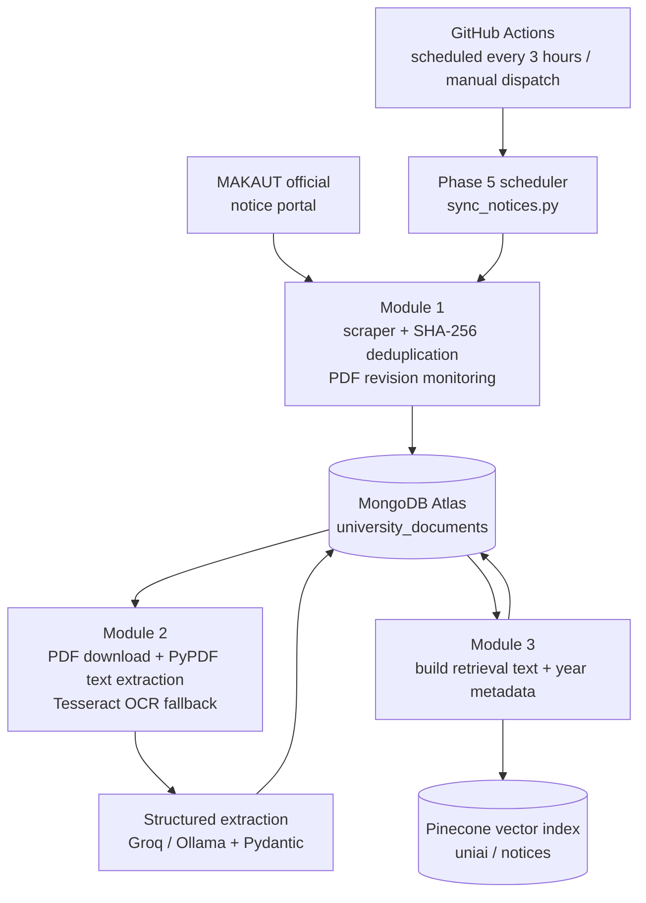
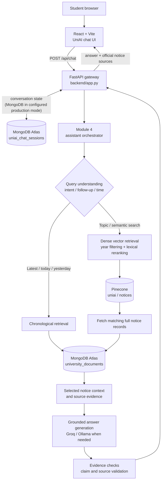

# UniAI — System & Backend Architecture

> Architectural reference for the [UniAI web demo](https://uniai.imfarhan-kol.workers.dev/) and the code in this repository. The diagrams describe the implemented application components and paths; they do not constitute a live uptime or infrastructure verification.

UniAI has **two independent workflows**: a scheduled **notice ingestion/indexing pipeline**, and an **on-demand conversational retrieval-augmented generation (RAG) API**. They share the MongoDB notice collection and Pinecone vector index.

## 1. Automated notice ingestion and indexing

The scheduler also uses a **temporary MongoDB Atlas runner-IP access rule** for its GitHub Actions job, and removes it after the run. It is a scheduled batch job, **not** a continuously running service. Module 2 temporarily handles downloaded PDFs for extraction; the canonical persistent notice data is held in MongoDB.

**Related code:** [GitHub Actions workflow](../.github/workflows/notice_sync.yml) · [scheduler](../backend/scheduler/sync_notices.py) · [scraper](../backend/Module1/scrapper.py) · [document processor](../backend/Module2/main.py) · [indexer](../backend/Module3/main.py).

## 2. Student question → evidence-grounded response

**Notes:**
- **Temporal requests** (for example, *"Show the latest 3 notices"*) use chronological MongoDB retrieval. **Semantic queries** (for example, *"What documents are required for WBJEE admission?"*) use Pinecone search with MongoDB record hydration and lexical reranking.
- **Follow-up requests** can reuse the active notice or previously cited records from conversation state rather than performing a fresh vector search. Some deterministic answer paths also bypass LLM generation; the diagram illustrates the general retrieval/generation route.
- **Conversation storage** depends on configuration: the FastAPI server uses MongoDB session persistence when `UNIAI_SESSION_STORAGE=mongo`, with an in-memory option for local development.
- The API returns `answer`, `sources`, and `conversation_id`. The UI presents the answer and clickable links to supporting official notice documents.
- Evidence checks are **safeguards**, not a guarantee that model answers can never be incorrect. Users should verify important dates, fees, and requirements against the linked official notice.

**Related code:** [FastAPI gateway](../backend/app.py) · [assistant](../backend/Module4/main.py) · [hybrid retrieval](../backend/retrieve.py) · [query understanding](../backend/Module4/query_understanding.py) · [evidence validation](../backend/Module4/evidence.py) · [frontend API client](../frontend/src/lib/api.js).

## 3. Technology map

| Layer | Implemented tools |
|---|---|
| University source | MAKAUT official notice portal and PDF circulars |
| Automation | GitHub Actions cron, Python scheduler |
| Acquisition | Requests, BeautifulSoup, SHA-256 deduplication and PDF revision checks |
| Document parsing | pypdf, Tesseract OCR, Pydantic V2, LLM extraction |
| Persistent document data | MongoDB Atlas (`university_documents`) |
| Semantic retrieval | Pinecone integrated embeddings (`uniai` index, `notices` namespace) |
| Answer pipeline | Python, LangChain components, Groq / local Ollama, server-side evidence checking |
| Chat API & session state | FastAPI, MongoDB-backed chat sessions or local in-memory mode |
| Web interface | React 18, Vite, Tailwind CSS |

## 4. Demo video walkthrough

1. **Show the student problem:** university notices are spread across many PDF circulars on the official portal.
2. **Show automated ingestion:** follow the first diagram from GitHub Actions → scraper → OCR/structured extraction → MongoDB → Pinecone.
3. **Switch to the [live UniAI website](https://uniai.imfarhan-kol.workers.dev/):** submit a question about a notice, then a follow-up, and open the attached official source.
4. **Explain the runtime pipeline:** browser → FastAPI → query intent → temporal/semantic retrieval → evidence checking → answer + sources.
5. **Finish on GitHub:** invite viewers to try the app, review the architecture, and share feedback or issues.

> **Presentation tip:** GitHub renders both Mermaid diagrams directly. For a video, zoom to each diagram and follow the arrows rather than scrolling through source files. Only demonstrate questions you have verified work against the deployed service.

## 5. Scope and operational boundaries

The frontend's public `workers.dev` URL identifies the demo entry point; this document does **not** assume the API runs in a Cloudflare Worker. Its backend hosting configuration is outside the architecture verified here. All MongoDB, Pinecone, and LLM credentials must remain on server-side or GitHub Actions secret storage, never in the React client.
